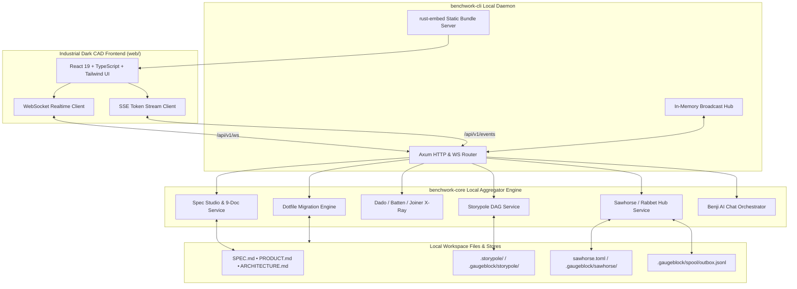
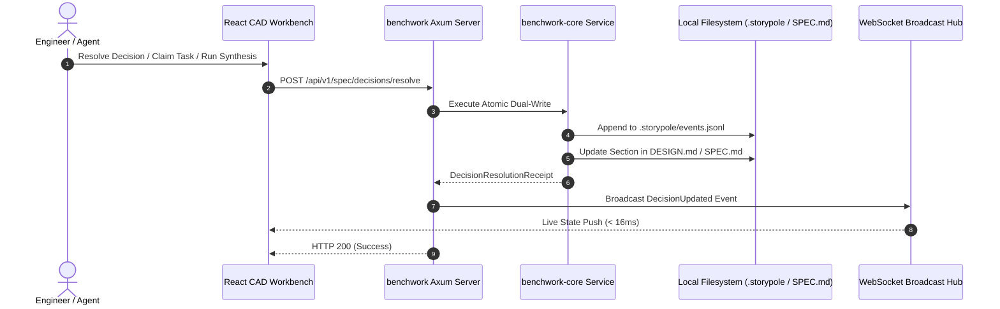

# `benchwork` — System Architecture

> **Domain:** Modular Visual Workbench & Local Aggregator | **Suite:** `gaugeblock`

This document details the software architecture, subsystem topology, dataflow, and real-time event distribution of `benchwork`.

---

## 1. System Decomposition

---

## 2. Real-Time Interaction & Dual-Write Flow

---

## 3. Storage & Aggregation Topology

`benchwork` acts as a zero-subprocess aggregator over all ecosystem state files:
* **Documentation & Contracts:** Monitored and parsed via `pulldown-cmark` and Tree-sitter in `benchwork-core::docs_service`.
* **Task Ledger & Backlog DAG:** Sourced directly via `storypole-core` event-sourced ledger queries and topological sort algorithms in `benchwork-core::dag_service`.
* **Synthesis & Hole Inspection:** Directly interrogates `dado-core` pattern templates and `batten-core` grammar constraints in `benchwork-core::xray_service`.
* **Model Inference Routing:** Direct reads and writes to `sawhorse.toml` through `sawhorse-core::config` in `benchwork-core::hub_service`.

---

## 4. Crate & Package Topology

| Crate | Path | Responsibility |
|:---|:---|:---|
| [`benchwork`](./src/lib.rs) | `.` | Root facade re-exporting `benchwork_core` domain APIs |
| [`benchwork-core`](./crates/benchwork-core) | `crates/benchwork-core` | State aggregation, DAG service, Spec studio, X-Ray, Benji orchestrator |
| [`benchwork-cli`](./crates/benchwork-cli) | `crates/benchwork-cli` | Axum HTTP/WS/SSE daemon, Clap CLI, static bundle embedder |
| [`benchwork-mcp`](./crates/benchwork-mcp) | `crates/benchwork-mcp` | Stdio Model Context Protocol (MCP) JSON-RPC 2.0 server |
| **`web/`** | `web/` | Industrial dark CAD UI (React 19, TypeScript, Tailwind, strictly $\le 250$ LOC/file) |
