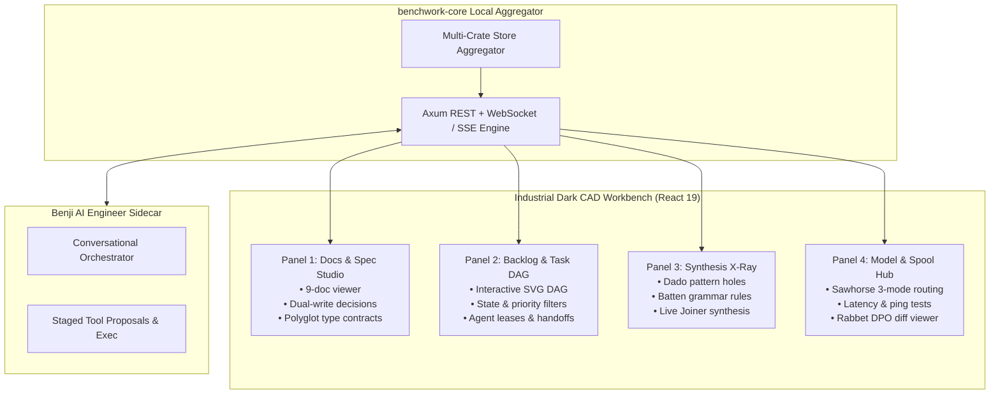

# `benchwork` — Modular Visual Workbench & Local Aggregator Daemon

[](https://gaugeblock.dev)
[](LICENSE)
[](https://github.com/gaugeblock)
[](ARCHITECTURE.md)

Part of the **[`gaugeblock`](https://gaugeblock.dev)** neurosymbolic code synthesis ecosystem.

> In traditional woodworking, a **workbench** is the sturdy, flat, multi-functional foundation of the shop—equipped with vises, bench dogs, holdfasts, and tool rails—where workpieces are clamped, shaped, planed, and assembled with precision. In the `gaugeblock` suite, `benchwork` is the single-binary visual command center (`benchwork up`): an industrial dark-mode CAD workbench uniting `SPEC.md`, live Storypole DAGs, Dado pattern X-Rays, Batten CFG rules, and the Benji AI engineer sidecar into a cohesive real-time control plane.

---

## 1. Why `benchwork`?

| Capability | Fragmented Suite Tools | With `benchwork` |
|:---|:---|:---|
| **User Experience** | Juggling 8 separate terminal windows and log files | **Single unified visual CAD workbench** (`benchwork up`) on port `4242` |
| **Workspace State** | Blind text parsing of disparate markdown and JSONL files | **Real-time multi-panel aggregation** (Docs, DAG, X-Ray, Model Hub) |
| **Architectural Decisions** | Manual edits to `SPEC.md` or unrecorded chat choices | **Interactive dual-write resolution** updating both markdown and storypole ledgers |
| **Agent Collaboration** | Invisible agent operations and hidden background state | **Interactive SVG CAD DAG** with live agent leases, heartbeats, and handoffs |
| **Synthesis Diagnostics** | Guessing why a pattern hole failed typechecking | **Dado/Batten/Joiner X-Ray viewer** with live AST hole inspections and DPO diffs |
| **AI Sidecar Integration** | External browser tabs disconnected from local code | **In-process Benji AI engineer** with staged tool execution and review workflows |

---

## 2. Workbench Panel Architecture



---

## 3. CLI Command Reference

The `benchwork` binary provides complete local daemon, diagnostic, and migration subcommands:

| Command | Options / Flags | Description |
|:---|:---|:---|
| `benchwork up` | `--host`, `--port`, `--dev`, `--static-dir` | Launches the visual workbench server and static UI daemon |
| `benchwork capabilities` | `--json` | Scans and reports detected workspace tools and enabled panels |
| `benchwork snapshot` | `--json` | Captures a unified state snapshot across all 4 panels |
| `benchwork migrate` | `--dry-run`, `--force`, `--json` | Migrates legacy workspace dotfiles into the canonical `.gaugeblock/` layout |
| `benchwork mcp` | *(none)* | Launches stdio JSON-RPC 2.0 Model Context Protocol server |

---

## 4. Model Context Protocol (MCP) Reference

When operating as an MCP server (`benchwork mcp`), `benchwork` exposes structured tools for AI agents:

| Tool Name | Parameters | Description |
|:---|:---|:---|
| `benchwork_capabilities` | *(none)* | Query detected ecosystem components and available feature panels |
| `benchwork_snapshot` | *(none)* | Retrieve full multi-panel state bundle (spec, DAG, X-Ray, hub) |
| `benchwork_resolve_decision` | `decision_id`, `choice`, `rationale` | Resolve pending architectural decision from AI agent or UI |
| `benchwork_trigger_synthesis` | `task_key`, `in_place` | Trigger neurosymbolic hole synthesis through Joiner daemon |

---

## 5. Crate & Package Topology

| Crate | Path | Responsibility |
|:---|:---|:---|
| [`benchwork`](./src/lib.rs) | `.` | Root facade re-exporting `benchwork_core` domain APIs |
| [`benchwork-core`](./crates/benchwork-core) | `crates/benchwork-core` | State aggregation, DAG service, Spec studio, X-Ray, Benji sidecar |
| [`benchwork-cli`](./crates/benchwork-cli) | `crates/benchwork-cli` | Axum HTTP/WS/SSE daemon, Clap CLI, embedded static bundle |
| [`benchwork-mcp`](./crates/benchwork-mcp) | `crates/benchwork-mcp` | Stdio Model Context Protocol (MCP) JSON-RPC 2.0 server |
| **`web/`** | `web/` | Industrial dark-mode CAD frontend in React 19, TypeScript, and Tailwind |

---

## 6. Quickstart

```bash
# 1. Install benchwork CLI globally
cargo install --path crates/benchwork-cli

# 2. Launch the visual workbench on http://127.0.0.1:4242
benchwork up

# 3. Frontend development mode (proxies UI requests to local Vite dev server)
benchwork up --dev

# 4. Migrate legacy configuration dotfiles to canonical .gaugeblock/
benchwork migrate

# 5. Export unified workspace snapshot as JSON
benchwork snapshot --json
```

---

## 7. Repository Documentation

`benchwork` adheres strictly to the canonical **9-Document Architecture**:
* **[`README.md`](./README.md):** Project overview, workbench metaphor, CLI reference, and panel architecture.
* **[`SPEC.md`](./SPEC.md):** Formal wire contracts, boundary types, migration invariants, and state machines.
* **[`ARCHITECTURE.md`](./ARCHITECTURE.md):** Subsystem decomposition, WebSocket/SSE engines, and aggregator flows.
* **[`DESIGN.md`](./DESIGN.md):** Concrete Architectural Decision Records (ADRs).
* **[`PRODUCT.md`](./PRODUCT.md):** Personas, user journeys, JTBD, and visual workbench strategy.
* **[`CONTRIBUTING.md`](./CONTRIBUTING.md):** Rust 2024 and React/Vite toolchain requirements and verification gates.
* **[`ROADMAP.md`](./ROADMAP.md):** Active milestones and upcoming workbench visualization capabilities.
* **[`CHANGELOG.md`](./CHANGELOG.md):** Historical version releases and pending changes.
* **[`AGENTS.md`](./AGENTS.md):** Non-negotiable engineering laws and autonomous execution directives.

---

## 8. License

Licensed under the Apache License, Version 2.0 ([`LICENSE`](./LICENSE)).
