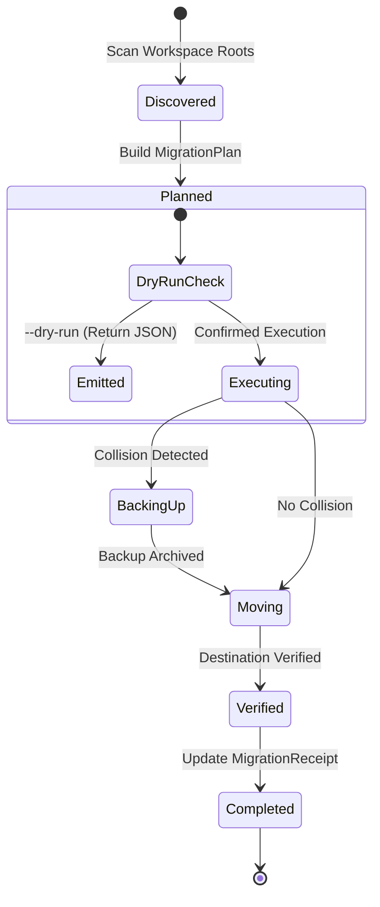
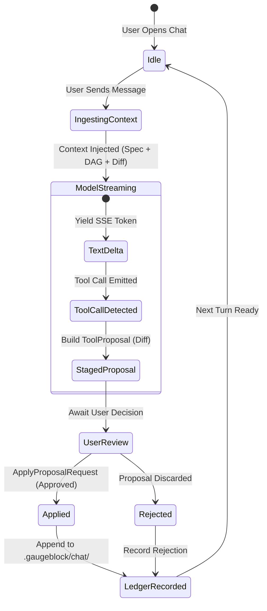

# `benchwork` — Behavioral Specifications & Invariants

> **Status:** Active Standard | **Domain:** Modular Visual Workbench & Local Aggregator | **Suite:** `gaugeblock`

This specification defines the formal wire contracts, behavioral invariants, dual-write synchronization protocols, and state machines for `benchwork`.

---

## 1. Behavioral Invariants

### Invariant 1: Direct In-Process Library Aggregation
`benchwork` MUST aggregate workspace state by linking directly against suite member library crates (`storypole-core`, `sawhorse-core`, `miter-engine`, `dado-core`) rather than spawning shell subprocesses. All data access occurs through direct Rust memory abstractions and SQLite/file handles, ensuring sub-millisecond query responses and zero shell injection vulnerabilities.

### Invariant 2: Dual-Write Architectural Decision Invariant
When an architectural decision is resolved through the visual workbench UI or MCP tool (`benchwork_resolve_decision`), `benchwork` MUST execute an atomic dual-write:
1. Append an immutable `DecisionRecorded` event to `.storypole/events.jsonl`.
2. Surgically update the corresponding markdown section in `DESIGN.md` or `SPEC.md` without disturbing surrounding markdown formatting.

### Invariant 3: Migration Safety & Idempotence
`benchwork migrate` MUST scan for legacy dotfiles (`.storypole/`, `.miter/`, `sawhorse.toml`, `.dado/`) and migrate them into the unified `.gaugeblock/` directory hierarchy:
* Pre-existing files in destination paths are backed up before relocation.
* Dry-run mode (`--dry-run`) reports all planned operations without modifying the filesystem.
* Consecutive runs on an already-migrated workspace produce zero modifications (`idempotent`).

### Invariant 4: Sub-16ms Real-Time Event Broadcast
Mutations originating from file changes, CLI commands, or background agent leases MUST be broadcast across WebSocket (`/api/v1/ws`) and Server-Sent Events (`/api/v1/events`) with end-to-end latency under 16 milliseconds (60 FPS UI frame budget).

### Invariant 5: Staged Tool Proposal & Approval Workflow
Benji AI engineer conversational tool calls MUST NOT execute side-effects directly. Instead, proposed mutations generate a staged `ToolProposal` rendered in the UI with unified diffs, requiring explicit user confirmation (`ApplyProposalRequest`) before applying modifications to disk.

---

## 2. Formal State Machines

### Migration Lifecycle State Machine

### Benji Chat Turn & Staged Proposal State Machine

---

## 3. Formal Type Contracts

The following 47 types define the complete public and boundary interface for `benchwork`:

| Type Name | Kind | Crate / Module | Description |
|:---|:---|:---|:---|
| **`AdminSubcommand`** | `enum` | `benchwork_cli::args` | Subcommands under admin maintenance |
| **`ApplyProposalRequest`** | `struct` | `benchwork_core::chat_harness` | Request payload to approve, reject, or edit a staged tool proposal |
| **`BenchworkError`** | `enum` | `benchwork_core::error` | Strongly-typed error enum for `benchwork-core` |
| **`BenchworkState`** | `struct` | `benchwork_core::lib` | Primary facade for accessing and mutating workspace state across crates |
| **`BulkArchiveRequest`** | `struct` | `benchwork_core::dag_service` | Request payload for archiving multiple tasks in a batch |
| **`BulkArchiveResponse`** | `struct` | `benchwork_core::dag_service` | Response payload from a bulk archiving operation |
| **`BulkArchiveResult`** | `struct` | `benchwork_core::dag_service` | Result summary of a bulk archive operation |
| **`ChatLedgerEvent`** | `enum` | `benchwork_core::chat_harness` | Event recorded in `.gaugeblock/chat/threads.jsonl` |
| **`ChatMessage`** | `struct` | `benchwork_core::chat_harness` | Single conversational message in a chat thread |
| **`ChatRole`** | `enum` | `benchwork_core::chat_harness` | Chat participant role (`User`, `Assistant`, `System`, `Tool`) |
| **`ChatStreamEvent`** | `enum` | `benchwork_core::chat_harness` | Typed event emitted across the Server-Sent Events (SSE) stream |
| **`ChatThread`** | `struct` | `benchwork_core::chat_harness` | Complete in-memory view of a conversation thread |
| **`ChatTurnRequest`** | `struct` | `benchwork_core::chat_harness` | Request payload for streaming a chat turn |
| **`ClaimTaskPayload`** | `struct` | `benchwork_core::dag_service` | Request payload for claiming an agent lease on a task |
| **`Cli`** | `struct` | `benchwork_cli::args` | Modular visual workbench UI and local aggregator daemon parser |
| **`Commands`** | `enum` | `benchwork_cli::args` | Available CLI subcommands (`Up`, `Capabilities`, `Snapshot`, `Migrate`, `Mcp`) |
| **`ContractPreviewRequest`** | `struct` | `benchwork_core::spec_studio` | Request to generate polyglot contracts from a `SharedTypeContract` |
| **`ContractPreviewResponse`** | `struct` | `benchwork_core::spec_studio` | Generated polyglot code preview (Rust, TypeScript, Python) |
| **`DaemonContext`** | `struct` | `benchwork_cli::daemon` | Shared daemon state passed to Axum route handlers |
| **`DagQuery`** | `struct` | `benchwork_core::dag_service` | Filter parameters for DAG board queries |
| **`DagStats`** | `struct` | `benchwork_core::dag_service` | Task state distribution counters |
| **`DecisionResolutionReceipt`** | `struct` | `benchwork_core::spec_studio` | Receipt confirming atomic dual-write of an architectural decision |
| **`DiscoverModelsRequest`** | `struct` | `benchwork_core::config_types` | Request payload for querying installed LLM providers |
| **`DiscoverModelsResponse`** | `struct` | `benchwork_core::config_types` | List of detected local and remote models |
| **`ExecuteMigrationRequest`** | `struct` | `benchwork_cli::daemon` | HTTP request payload to execute a pending migration plan |
| **`FormatArgs`** | `struct` | `benchwork_cli::args` | Arguments for formatting output as JSON |
| **`HoleCompileRequest`** | `struct` | `benchwork_core::model` | Request to compile a typed hole synthesis candidate |
| **`HoleCompileResponse`** | `struct` | `benchwork_core::model` | Compiler validation verdict for hole synthesis |
| **`InferencePingRequest`** | `struct` | `benchwork_core::hub_service` | Request to measure latency of an inference provider |
| **`InferencePingResponse`** | `struct` | `benchwork_core::hub_service` | Measured ping latency and provider health status |
| **`MigrateArgs`** | `struct` | `benchwork_cli::args` | CLI arguments for `benchwork migrate` command |
| **`MigrateRequest`** | `struct` | `benchwork_cli::daemon` | HTTP request to trigger dotfile migration |
| **`MigrationItem`** | `struct` | `benchwork_core::migration` | Single dotfile item scheduled for migration |
| **`MigrationItemStatus`** | `enum` | `benchwork_core::migration` | Status of an individual migration item |
| **`MigrationPlan`** | `struct` | `benchwork_core::migration` | Complete migration plan across all detected suite dotfiles |
| **`MigrationReceipt`** | `struct` | `benchwork_core::migration` | Detailed summary receipt of executed migration |
| **`ModelHubStatus`** | `struct` | `benchwork_core::hub_service` | Aggregated provider status across all 3 Sawhorse execution modes |
| **`ResolveDecisionRequest`** | `struct` | `benchwork_core::spec_studio` | Payload to resolve an architectural decision from UI or MCP |
| **`RoleOverrideConfig`** | `struct` | `benchwork_core::config_types` | Per-role model provider override configuration |
| **`ScaffoldRequest`** | `struct` | `benchwork_cli::daemon` | Request payload to scaffold canonical 9-document architecture |
| **`ServerConfig`** | `struct` | `benchwork_cli::daemon` | Daemon HTTP bind, port, and dev proxy configuration |
| **`SpecDocsStatus`** | `struct` | `benchwork_core::spec_studio` | Document compliance and drift status for the 9 canonical docs |
| **`SynthesisRunRequest`** | `struct` | `benchwork_core::model` | Request payload to trigger neurosymbolic synthesis run |
| **`TestInferenceReceipt`** | `struct` | `benchwork_core::config_types` | Result of testing prompt completion across a model role |
| **`TestInferenceRequest`** | `struct` | `benchwork_core::config_types` | Request payload for test prompt completion |
| **`UniversalModelConfig`** | `struct` | `benchwork_core::config_types` | Unified model configuration schema unifying Sawhorse and Benchwork |
| **`UpArgs`** | `struct` | `benchwork_cli::args` | CLI options for `benchwork up` server command |
